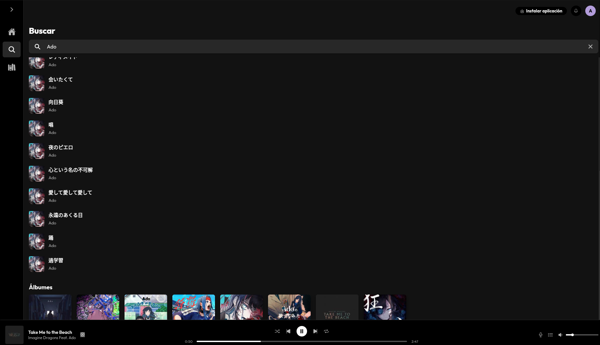
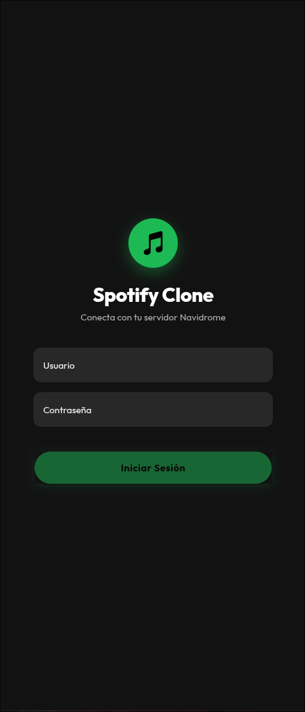
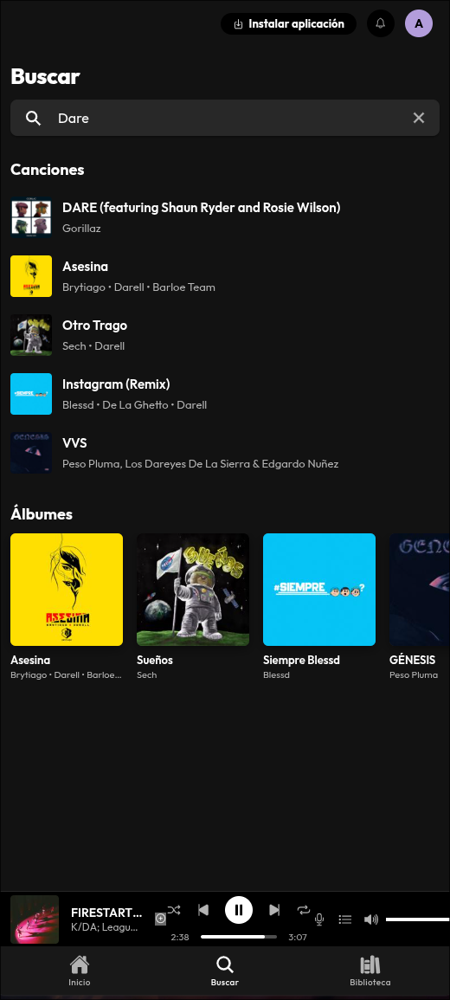
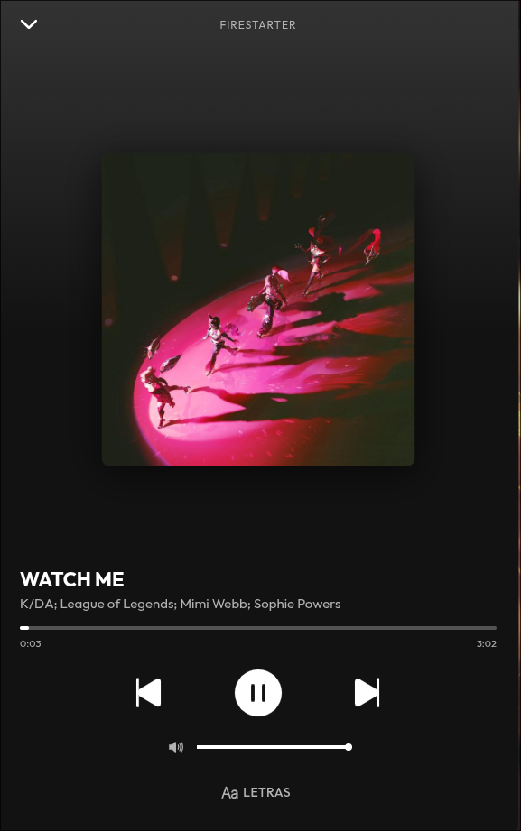
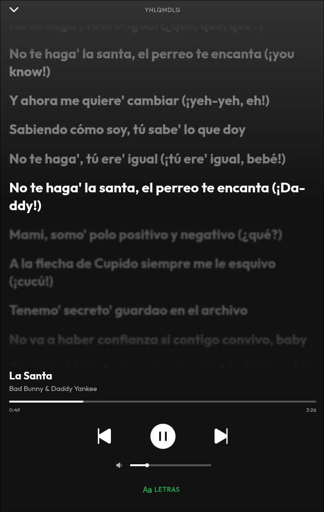

# 🎵 Spotify Clone + Navidrome Server

Un reproductor de música multiplataforma (Web y Android) con diseño fiel a **Spotify**, alimentado por un servidor personal **Navidrome** a través de la API Subsonic, con soporte para letras sincronizadas (`.lrc`).

---

## Características

- **Diseño Responsive Adaptativo:**
  - **Móvil:** Navegación por pestañas inferiores (*Tab Bar*), mini-reproductor flotante y vistas táctiles optimizadas.
  - **Escritorio:** *Sidebar* lateral colapsable (solo iconos / extendido) y barra superior de perfil de usuario.
- **Integración con Navidrome:** Autenticación y consumo de biblioteca musical en tiempo real mediante la API Subsonic.
- **Letras Sincronizadas (`.lrc`):** Visualización animada de letras integradas y descargadas.
- **Controles de Reproducción:** Control de volumen, barra de búsqueda (*seek bar*), tiempo de reproducción, aleatorio (*Shuffle*) y repetición (*Repeat*).
- **Multiplataforma:** Aplicación Web (PWA) y App nativa para Android empacada con **Capacitor**.

---

## 🛠️ Tecnologías Utilizadas

### Frontend & App Móvil
- **Angular (v17+):** Uso de *Standalone Components*, *Signals* y *RxJS* para manejo del estado reactivo.
- **Ionic Framework (`@ionic/angular`):** Componentes UI adaptativos (`ion-tabs`, `ion-popover`, `ion-range`, `ion-icon`).
- **Capacitor:** Compilación e integración nativa para Android.
- **SCSS:** Estilos personalizados en modo oscuro con Flexbox y CSS Grid.

### Backend & Infraestructura
- **Navidrome:** Servidor de streaming ligero compatible con la API Subsonic.
- **Syncedlyrics:** Servicio secundario para la obtención de letras `.lrc`.
- **Docker & Docker Compose:** Contenerización y orquestación del servidor.

---

##  Configuración Docker (`docker-compose.yml`)

El servidor de música y el sincronizador de letras se ejecutan mediante Docker Compose con la siguiente configuración:

```yaml
services:
  navidrome:
    image: docker.io/deluan/navidrome:latest
    container_name: navidrome
    dns:
      - 8.8.8.8
      - 1.1.1.1
    ports:
      - "4533:4533"
    restart: unless-stopped
    environment:
      ND_LOGLEVEL: "info"
      ND_LYRICSPRIORITY: ".lrc,embedded"
      ND_SCANSCHEDULE: "@every 1h"
      ND__ENABLEEXTERNALSERVICES: "true"
      ND_REVERSEPROXYWHITELIST: "192.168.0.0/16,172.16.0.0/12,10.0.0.0/8"
      ND_SCANNER_EXTRACTOR: "atp"
    volumes:
      - "/home/iteza/docker/navidrome_data/data:/data"
      - "/mnt/DATOS/compartida/Music/:/music:ro"

  syncedlyrics:
    build: .
    container_name: syncedlyrics
    restart: unless-stopped
    volumes:
      - "/mnt/DATOS/compartida/Music/:/music"
```

---

## ⚙️ Guía de Instalación y Despliegue

### 1. Iniciar los Servicios del Backend

```bash
# Crear directorio para la base de datos de Navidrome
mkdir -p /home/iteza/docker/navidrome_data/data

# Desplegar contenedores Docker
docker compose up -d
```

> Accede a `http://localhost:4533` (o la IP de tu servidor) para configurar el usuario administrador inicial en Navidrome.

---

### 2. Ejecutar el Proyecto Web

1. **Clonar e instalar dependencias:**
   ```bash
   git clone <URL_DE_TU_REPOSITORIO>
   cd spotify-clone
   npm install
   ```

2. **Iniciar servidor de desarrollo:**
   ```bash
   ng serve
   ```
   Navega a `http://localhost:4200` e inicia sesión con las credenciales de tu cuenta de Navidrome.

---

### 3. Compilar para Android (Capacitor)

#### Requisitos Previos:
- **Android Studio** configurado con Android SDK.
- **Opciones de desarrollador** y **Depuración por USB** (e *Instalar por USB*) activadas en el dispositivo móvil.

#### Pasos:

```bash
# 1. Agregar la plataforma de Android (solo la primera vez)
npm install @capacitor/android
npx cap add android

# 2. Generar el bundle de producción de Angular
ng build --configuration production

# 3. Sincronizar archivos con la carpeta nativa
npx cap sync android
```

#### Modos de Ejecución:

- **Live Reload (Prueba rápida por Wi-Fi):**
  ```bash
  npx cap run android -l --external
  ```
- **Android Studio (Generación de APK / Debugging):**
  ```bash
  npx cap open android
  ```
  *(En Android Studio selecciona tu dispositivo físico y presiona `Run ▶` o ve a `Build > Build APK(s)`)*.

---

##  Estructura del Proyecto

```text
src/app/
├── components/
│   ├── lyrics/          # Visor de letras de canciones (.lrc)
│   ├── mini-player/     # Reproductor inferior (Web/Escritorio y Flotante Móvil)
│   └── user-menu/       # Menú emergente de perfil de usuario y cierre de sesión
├── pages/
│   ├── album/           # Vista de detalle del álbum
│   ├── home/            # Inicio con escuchados recientemente y álbumes
│   ├── library/         # Biblioteca del usuario
│   ├── login/           # Pantalla de inicio de sesión con Navidrome
│   ├── player/          # Vista de reproductor a pantalla completa
│   └── search/          # Búsqueda de canciones y álbumes
├── services/
│   ├── auth.service.ts  # Autenticación y token Subsonic
│   ├── navidrome.service.ts # Consultas a la API del servidor Navidrome
│   └── player.service.ts    # Estado global de audio, colas y progreso
└── tabs/                # Layout contenedor (Sidebar Desktop / Tab Bar Móvil)
```
## Capturas de Pantalla

### Escritorio
<p align="center">
  
</p>

<br>

### Aplicación Móvil

<div align="center">
  <table>
    <tr>
      <td align="center"><b>Inicio de Sesión</b></td>
      <td align="center"><b>Búsqueda</b></td>
      <td align="center"><b>Reproductor</b></td>
      <td align="center"><b>Letras</b></td>
    </tr>
    <tr>
      <td align="center" width="25%">
        
      </td>
      <td align="center" width="25%">
        
      </td>
      <td align="center" width="25%">
        
      </td>
      <td align="center" width="25%">
        
      </td>
    </tr>
  </table>
</div>
